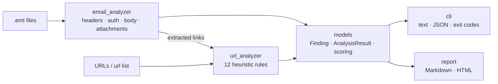

# 🎣 PhishGuard — Offline Phishing Email & URL Analyzer


 

PhishGuard is a defensive security tool that triages suspicious emails (`.eml`) and URLs the way a SOC analyst would. It parses email headers and bodies, checks sender authentication results (SPF/DKIM/DMARC), finds spoofing and deceptive links, and scores each artifact with explainable rules mapped to **MITRE ATT&CK**. It runs **fully offline** with only the Python standard library and writes text, JSON, Markdown, or HTML reports.

## ✨ Features
- **Header forensics**: From / Reply-To / Return-Path mismatch, display-name spoofing, SPF/DKIM/DMARC failures
- **Content analysis**: urgency/pressure language, link-text vs. real-destination mismatch
- **Attachment checks**: risky extensions and double-extension tricks (`invoice.pdf.exe`)
- **URL heuristics (12 rules)**: IP-literal hosts, `@` userinfo trick, punycode homographs, high-abuse TLDs, shorteners, excessive subdomains, brand impersonation, lure keywords, DGA-like entropy, direct executable downloads
- **Risk scoring** (0–100) → `LIKELY SAFE` / `SUSPICIOUS` / `PHISHING`
- **MITRE ATT&CK mapping**: T1566, T1566.001, T1566.002, T1656
- **Reports**: console, JSON (for SIEM/SOAR pipelines), Markdown, styled HTML
- **CI-friendly exit codes**: `0` safe, `1` suspicious, `2` phishing

## 🏗 Architecture


```
phishguard/
├── phishguard/        # package: cli, email_analyzer, url_analyzer, models, report
├── samples/           # realistic demo emails + URL list (safe, fictitious)
├── reports/           # example generated reports
├── tests/             # pytest suite
└── .github/workflows/ # CI
```

## ⚙️ Install
```bash
git clone https://github.com/sapkotaankit321-cyber/phishguard-phishing-analyzer.git
cd phishguard-phishing-analyzer
python3 -m venv .venv && source .venv/bin/activate
pip install -r requirements.txt   # only pytest; the tool itself is stdlib-only
```

## 🚀 Usage
```bash
python -m phishguard email samples/                              # analyze a folder of .eml files
python -m phishguard email samples/ --format html -o report.html # HTML report
python -m phishguard url "http://192.0.2.10/office365/login.php" # single URL
python -m phishguard url -f samples/urls.txt --format json       # bulk URLs as JSON
```

### Example output
```
[ PHISHING  ]  90/100  samples/invoice_malware.eml
    - EML005 (medium) Urgency / pressure language: immediately, final notice
    - EML007 (high) Risky attachment type: invoice_44871.pdf.exe
    - URL001 (high) IP address used as host: 198.51.100.23
    - URL012 (high) Direct link to executable/archive: /files/invoice.zip
[LIKELY SAFE]   0/100  samples/legit_newsletter.eml
[ PHISHING  ] 100/100  samples/paypal_credential_phish.eml
    - EML001 (high) Reply-To domain differs from From
    - EML003 (high) Display name spoofs another domain
    - EML004 (high) DMARC fail
    - EML006 (high) Link text does not match destination: shows www.paypal.com -> paypal.com.account-verify.login.secure-id.xyz
    - URL009 (high) Brand name outside registered domain: 'paypal' on secure-id.xyz
```
See [`reports/sample_report.md`](reports/sample_report.md) and `reports/sample_report.html` for full reports.

## 🧪 Tests
```bash
pytest -v
```
GitHub Actions runs the suite on Python 3.9, 3.11 and 3.12 on every push and pull request.

## 🧠 Skills Demonstrated
- Email security: RFC 5322 parsing, SPF/DKIM/DMARC interpretation, header forensics
- Threat detection engineering: explainable heuristic rules, weighted risk scoring
- Threat intelligence frameworks: MITRE ATT&CK mapping
- Secure Python development: modular design, type hints, docstrings, argparse CLI, no third-party runtime dependencies
- Testing & DevOps: pytest, GitHub Actions CI matrix
- Security reporting for analysts (HTML/Markdown) and automation (JSON, exit codes)

## ⚖️ Ethical Use
PhishGuard is a **defensive** tool for analyzing messages you own or are authorized to investigate (e.g. your own inbox or a SOC queue). It never contacts URLs or sends mail. All sample data uses fictitious domains and RFC 5737 documentation IP ranges. Do not use it to craft or improve phishing campaigns.

## 🔭 Future Improvements
- Optional threat-intel lookups (VirusTotal, URLhaus, PhishTank) behind an `--online` flag
- Real DKIM signature verification and public-suffix-list domain parsing
- Levenshtein/homoglyph similarity against a brand allow-list (typosquat detection)
- ML classifier trained on public phishing corpora alongside the rules
- IMAP / Microsoft Graph mailbox ingestion and a small web dashboard
- YAML-configurable rule weights and STIX 2.1 export
